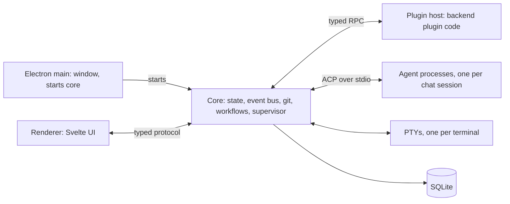

<!-- Part of the yaa spec. Imported from the planning doc; this repo is now the source of truth. -->

## Overview

A keyboard-first desktop IDE where every unit of work is a git worktree with its own agent chat, diff review, terminal and cost counter. The core stays small; almost everything else (git panel, PR/MR, Jira, chat extras) is a plugin built on the same API that third parties and agents use.

**Goals**

- Fast: the UI never blocks on agents, git or the network; panel and worktree switches feel instant.
- Keyboard-navigable everywhere, with an optional vim layer, but a graphical grid UI and not a TUI.
- Worktree-first: projects show their default branch and worktrees; creating, switching and closing worktrees is the main flow.
- Simple and beautiful: a small set of design tokens and a small set of reusable components.
- Extensible: plugins add panels, header and footer items, commands, settings, connectors and agent providers, expose functions to other plugins, and can be written by an agent and hot-reloaded in dev mode.

**Non-goals for v1**

- Not a VS Code replacement: no debugger, no VS Code extension compatibility, no language features beyond what Monaco provides.
- No hosted service: everything runs locally.
- No custom agent: the app drives existing agents, GitHub Copilot CLI and Claude Code first, then Pi and Hermes.

**Working principles**

- Iterative: ship a thin vertical slice first (see `docs/plan.md`), then widen.
- No duplication: one primitive per job, composed upward; extract on the second use.

## Architecture

The UI is a thin client: a separate backend process owns worktrees, agents, git and plugins, and the UI subscribes to its events.

- **Renderer:** sends commands and renders events. It keeps no business state, so a reload or a second window sees the same state.
- **Core:** owns state and the event bus. Plugin code runs in its own host process, so a crashing plugin does not stop the core or the agents.
- **Agents and terminals:** core spawns, supervises and talks to every agent process and PTY, one agent per chat session, started in its worktree directory. A provider plugin supplies detection, spawn configuration and capability data, but never holds the process or the ACP connection. A plugin host crash therefore leaves running agents and terminals untouched. Electron's main process only creates the window and starts the backend.
- **Contracts:** one typed protocol package shared by the UI, the core and the plugin API. Every message, plugin manifest and settings file has a runtime schema in this package, and the core validates input from the renderer, plugins and disk against it. TypeScript types are inferred from the schemas, so there is one definition per message.

**Transport security (proposed, decided in M1)**

The core can run shell commands, so the channel to it must not be open to other local processes or to web pages.

- Preferred: run the core as an Electron `utilityProcess` and connect the renderer through a `MessagePort`. No network port is opened.
- If a WebSocket is kept, for example for a second window or a dev browser, it binds to `127.0.0.1` only, requires a random per-launch token, and rejects any `Origin` other than the app's own.
- The renderer runs with context isolation on, the sandbox on, `nodeIntegration` off and a strict content security policy. It only reaches the core through the preload bridge.
